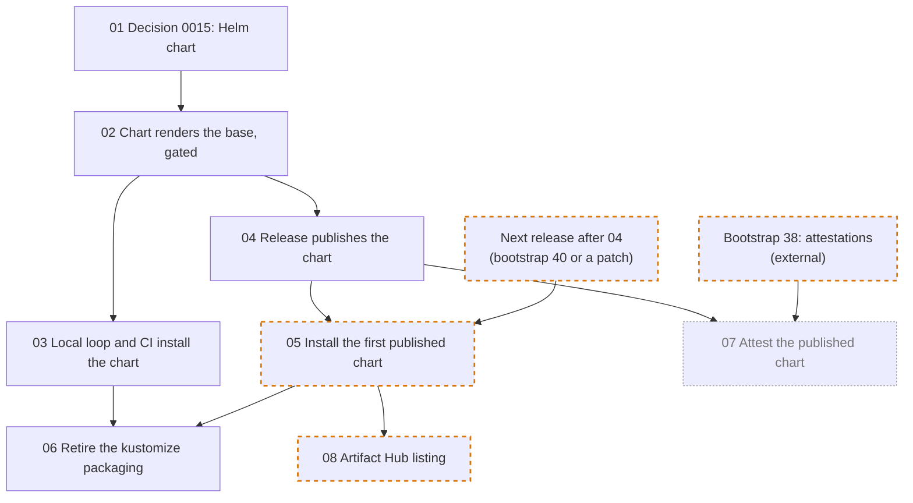

# Helm chart round: ticket order

The tickets live in [issues/](issues/). They carry out the maintainer's 2026-10-16 decision to ship knarr as a Helm chart on ghcr.io for ease of adoption. Helm becomes the only supported install, and the kustomize packaging retires at the end. Ticket [01](issues/01-helm-chart-decision.md) records that decision as Decision 0015.

Each arrow points from a blocker to the ticket it unblocks, exactly as the ticket's **Blocked by** line states. A dashed orange border marks a `needs-human` ticket (a live session with the maintainer) or an external dependency. A dotted grey border marks a ticket off the chart's critical path. Ticket 08 is both: it is marked `needs-human`, and this paragraph records that it is off the path.

## Branches

Each ticket is worked on its own branch, in its own git worktree, as the root [README](../../README.md#branches-and-worktrees) states. The branch name is the ticket's file name without `.md`, so [02](issues/02-chart-renders-base.md) is worked on `02-chart-renders-base`. Numbers are per directory: this round's 02 is not bootstrap ticket 02. When a ticket here names a bootstrap ticket, it says "bootstrap".

## Execution waves

A wave is the earliest point a ticket can start if every lane runs in parallel: one step after its latest blocker. `needs-human` tickets also wait for a maintainer session, and 05 also waits for a release.

| Wave | Tickets |
| --- | --- |
| 0 | [01](issues/01-helm-chart-decision.md) |
| 1 | [02](issues/02-chart-renders-base.md) |
| 2 | [03](issues/03-local-loop-and-ci-install-chart.md), [04](issues/04-release-publishes-chart.md) |
| 3 | [05](issues/05-install-first-published-chart.md), [07](issues/07-attest-published-chart.md) |
| 4 | [06](issues/06-retire-kustomize-packaging.md), [08](issues/08-artifact-hub-listing.md) |

The longest chain is five tickets: 01, 02, 04, 05, then 06 or 08. Ticket 07 also waits for bootstrap ticket [38](../bootstrap/issues/38-attestations-sbom-arm64.md). None of these tickets is on the MVP critical path: the MVP installs through Decision 0012's kustomize route.

When a ticket's **Blocked by** line changes, update both the diagram and this table.
