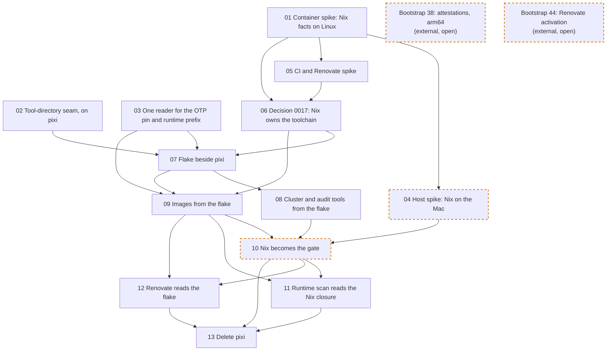

# Nix migration round: ticket order

The tickets live in [issues/](issues/). They carry out the maintainer's 2026-11-14 decision to move knarr's toolchain from pixi to Nix: every tool, and the Erlang runtime in both images, comes from one flake and its `flake.lock`. Ticket [06](issues/06-nix-decision-record.md) records that as Decision 0017, which supersedes [Decision 0003](../../docs/decisions/0003-tool-manager.md).

What the maintainer settled before the tickets were drafted:

- Nix replaces pixi in the prerequisite list. Docker, git and a POSIX shell stay on the host. Nothing else on a machine is managed by Nix: no nix-darwin, no home-manager, no global profile.
- Hex packages stay with gleam. `gleam.toml` and `manifest.toml` keep pinning them, and `just initialize` keeps one `gleam deps download` step.
- The shipped image moves too, so the round ends with `pixi.toml`, `pixi.lock`, `tools.txt` and `scripts/install-tools.sh` deleted.
- One locked nixpkgs revision supplies ordinary tools. An exact version is held only where evidence or a rule depends on it: Erlang/OTP with its OpenSSL, Gleam, and the Kubernetes skew caps (kind, kubectl, node images).
- The other pinned downloads are out of scope: the kind node and kwok images, the KEDA manifest, the observability chart tarballs, the vendored Kubernetes schemas, action SHAs and the Ubuntu base digest stay as they are.

The order is expand–contract, because pixi paths are read by the gate itself (`lock-check`, `env-check`, the pin tests) and no partial swap lands green. 01 and 05 gather the Nix facts and 06 records the decision. 04 confirms them on the Mac before 10. 02 and 03 put one seam in front of the tool directories while everything still runs on pixi. 07 adds the flake beside pixi, selected by `KNARR_TOOLS`. 08 and 09 move the cluster tools and the images. 10 flips the default. 13 deletes pixi.

Each arrow points from a blocker to the ticket it unblocks, exactly as the ticket's **Blocked by** line states. A dashed orange border marks a `needs-human` ticket (a live session with the maintainer) or an external ticket. Bootstrap tickets 38 and 44 are shown because they are open and touch the same files; neither blocks a ticket here.

## Branches

Each ticket is worked on its own branch, in its own git worktree, as the [contributing guide](../../CONTRIBUTING.md#create-the-ticket-worktree) states. The branch name is the ticket's file name without `.md`, so [02](issues/02-tool-directory-seam.md) is worked on `02-tool-directory-seam`. Numbers are per directory: this round's 01 is not bootstrap ticket 01. When a ticket here names another round's ticket, it names the round.

01, 04 and 05 change no tracked file except their own ticket, their evidence under `evidence/` and, for 01, the evidence excludes in the hook and linter configs.

## Where Nix runs until 04

The maintainer chose on 2026-11-14 to start the round before installing Nix on the Mac. Until 04, Nix runs in two places only: a digest-pinned Linux container on the host's Docker, and the CI runner.

- A container works on a `git clone` of the branch in a container volume, with `/nix` on a named volume. It never runs the gate or `just initialize` on a bind-mounted worktree: that would overwrite the Mac's `.pixi/`, `.tools/` and `build/`, and a linked worktree's `.git` does not resolve inside the mount.
- Three systems are in play: aarch64-linux in the container, x86_64-linux in CI and in the released image, and aarch64-darwin on the Mac. Linux can evaluate the darwin outputs and ask the binary cache about them, but cannot run them.
- A box that says the Nix backend passes is ticked from a Linux transcript, and the hand-back says which system it ran on. Decision 0017 lists what is unverified on darwin, and 04 closes that list before 10 makes Nix the default.

## Two backends until 13

From 07 until 13 the repository carries both backends. `KNARR_TOOLS=pixi|nix` selects one for a whole command, never a mix. The tracked default is pixi until 10 and Nix after it. One backend is authoritative for each commit: the gate must pass on the default, and the other is a measurement.

The OTP version has one owner throughout. Until 07 it is the `erlang` pin in `pixi.toml`. From 07 it is the held-versions file the flake reads, and a test holds `pixi.toml` equal to it until 13 deletes `pixi.toml`.

## No release between 09 and 11

After 09 the image's runtime is a Nix closure, but `just runtime-scan` still looks for a conda environment until 11 lands, so the weekly scan cannot decide. Nobody pushes a release tag between 09's merge and 11's.

The release workflow cannot be exercised by a pull request. The first release after 09 is an `-rc` tag.

## Other rounds' open tickets

- Bootstrap [38](../bootstrap/issues/38-attestations-sbom-arm64.md) (attestations, SBOM, arm64) names the pixi re-lock route for arm64. 09 updates its text.
- Bootstrap [44](../bootstrap/issues/44-renovate-activation.md) (Renovate activation) is not done, so Renovate is configured but not running. 12 changes the configuration only and does not activate the app.

## Execution waves

A wave is the earliest point a ticket can start if every lane runs in parallel: one step after its latest blocker. `needs-human` tickets also wait for a maintainer session.

| Wave | Tickets |
| --- | --- |
| 0 | [01](issues/01-nix-container-spike.md), [02](issues/02-tool-directory-seam.md), [03](issues/03-pin-and-prefix-readers.md) |
| 1 | [04](issues/04-nix-host-spike.md), [05](issues/05-nix-ci-renovate-spike.md) |
| 2 | [06](issues/06-nix-decision-record.md) |
| 3 | [07](issues/07-flake-beside-pixi.md) |
| 4 | [08](issues/08-cluster-audit-tools-from-flake.md), [09](issues/09-images-from-flake.md) |
| 5 | [10](issues/10-nix-becomes-the-gate.md) |
| 6 | [11](issues/11-runtime-scan-nix-closure.md), [12](issues/12-renovate-reads-flake.md) |
| 7 | [13](issues/13-delete-pixi.md) |

The longest chain is eight tickets: 01, 05, 06, 07, 08, 10, 11, 13.

When a ticket's **Blocked by** line changes, update both the diagram and this table.
