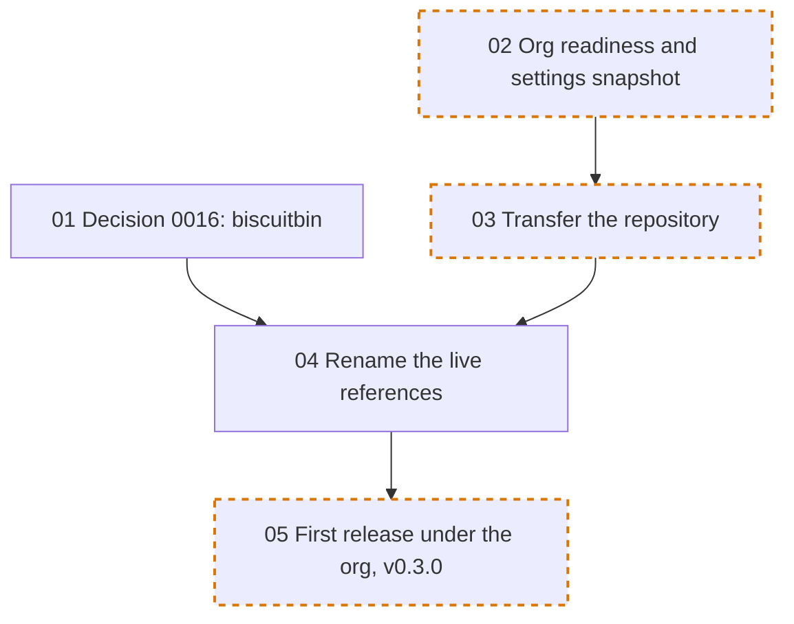

# Org transfer round: ticket order

The tickets live in [issues/](issues/). They move knarr from `github.com/steven-cutting/knarr` to `github.com/biscuitbin/knarr` by GitHub's repository transfer, and publish every release from `v0.3.0` on under `ghcr.io/biscuitbin/…`. Ticket [01](issues/01-biscuitbin-decision.md) records that decision as Decision 0016.

Each arrow points from a blocker to the ticket it unblocks, exactly as the ticket's **Blocked by** line states. A dashed orange border marks a `needs-human` ticket (a live session with the maintainer).

## Branches

Each ticket is worked on its own branch, in its own git worktree, as the root [README](../../README.md#branches-and-worktrees) states. The branch name is the ticket's file name without `.md`, so [04](issues/04-rename-live-references.md) is worked on `04-rename-live-references`. Numbers are per directory: this round's 04 is not helm chart ticket 04 or bootstrap ticket 04. When a ticket here names another round's ticket, it names the round.

02 and 03 change no tracked file except their own ticket and evidence. They are sessions with the maintainer, and their branches carry only the record.

## No release between 03 and 04

After the transfer, `release.yml` still names `ghcr.io/steven-cutting/…`, and the org repository's `GITHUB_TOKEN` cannot push to the maintainer's personal namespace. A tag pushed between 03 and 04's merge would fail at the image push. Nobody pushes a release tag until 04 merges.

## Execution waves

A wave is the earliest point a ticket can start if every lane runs in parallel: one step after its latest blocker. `needs-human` tickets also wait for a maintainer session.

| Wave | Tickets |
| --- | --- |
| 0 | [01](issues/01-biscuitbin-decision.md), [02](issues/02-org-readiness-snapshot.md) |
| 1 | [03](issues/03-transfer-repository.md) |
| 2 | [04](issues/04-rename-live-references.md) |
| 3 | [05](issues/05-first-release-under-org.md) |

The longest chain is four tickets: 02, 03, 04, 05. Helm chart ticket [08](../helm-chart/issues/08-artifact-hub-listing.md) waits for 05, so the Artifact Hub listing is registered once, under the org.

When a ticket's **Blocked by** line changes, update both the diagram and this table.
