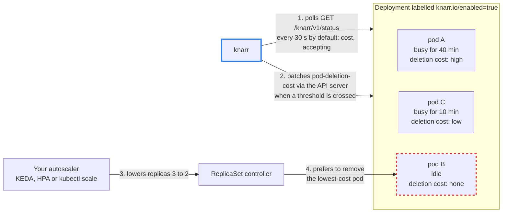

# Knarr

A Kubernetes controller, written in Gleam on the BEAM, that biases Deployment scale-down away from busy worker pods. It polls workers over HTTP and sets `controller.kubernetes.io/pod-deletion-cost` on live pods.

**Status: early, pre-1.0.** knarr manages the Deployments in its namespace that carry the label `knarr.io/enabled=true`. It polls each of their pods' `GET /knarr/v1/status` and sets `pod-deletion-cost` from the reading. When a Deployment opts out, knarr removes the annotations it owns. It serves health, readiness and Prometheus metrics endpoints. It never changes a replica count or a Deployment's pod template, and it stops patching a pod once the pod is terminating. The `cluster-autoscaler.kubernetes.io/safe-to-evict` policy is not implemented yet. knarr has not yet been accepted on a production GKE Standard workload.

## How it works

Each worker pod reports how long its current work has been running. knarr turns that into the pod's `pod-deletion-cost` annotation, so when your autoscaler removes a replica, Kubernetes prefers to remove an idle pod over a busy one.



The bias is best-effort: Kubernetes compares deletion cost only after node assignment, phase and readiness, so a busy pod can still be chosen. Each worker must handle SIGTERM by draining on its own, with enough termination grace to finish its in-flight work. [Prepare a worker](docs/how-to/worker.md) covers the status endpoint and drain, and the [project overview](docs/OVERVIEW.md#4-how-it-works-conceptual) has the full loop and its limits.

## Install

knarr ships as a Helm chart. Set `chart_version` to a release version and `worker_namespace` to the existing namespace whose Deployments knarr should manage. Installing changes your selected cluster, so check the context first:

```sh
chart_version=X.Y.Z
worker_namespace=workers
kubectl config current-context
helm install knarr oci://ghcr.io/biscuitbin/charts/knarr \
  --version "$chart_version" --namespace "$worker_namespace" --wait
```

Before installing, read the [install guide](docs/how-to/install.md). It lists the prerequisites (an amd64 Linux cluster, Helm 4 and a working PodDeletionCost), shows how to verify the image and chart attestations and install by digest, and covers upgrades and uninstalling.

## Using knarr

- [Install a published release](docs/how-to/install.md): install the Helm chart in one namespace, upgrade, install with kubectl only, and uninstall.
- [Prepare a worker](docs/how-to/worker.md): expose status, drain safely, and choose readiness behavior.
- [Deployment configuration](docs/reference/configuration.md): opt in and tune the supported overrides.
- [Pair Knarr with KEDA](docs/how-to/keda.md): external demand, scale-from-zero, and scale-down tuning.
- [Operate and remove Knarr](docs/operations/controller.md): prerequisites, NetworkPolicy, monitoring, rollouts, and recovery.

The [project overview](docs/OVERVIEW.md) covers goals, the worker contract draft and open questions, and the [documentation index](docs/README.md) links the whole handbook.

## Contributing

The [contributing guide](CONTRIBUTING.md) covers local setup, the gate, audits and pins, specifications, tickets and getting a change merged. AI agents start at [AGENTS.md](AGENTS.md). Report vulnerabilities privately as the [security policy](SECURITY.md) describes; the [changelog](CHANGELOG.md) records notable changes by release.

## Licence

knarr is licensed under the [Apache License 2.0](LICENSE).
